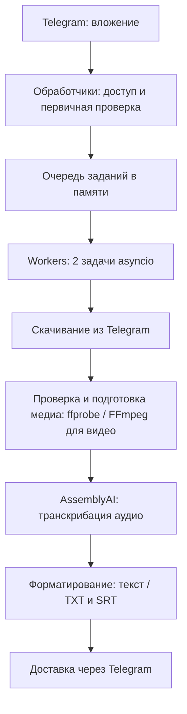

# Transcribe Bot — Telegram Audio & Video Transcription

Telegram-бот преобразует голосовые сообщения, аудио и видео в текст с разделением
говорящих, таймкодами и экспортом субтитров SRT при наличии временных меток.
Проект объединяет асинхронную обработку заданий на Python, интеграцию с AssemblyAI
и локальную подготовку медиа через FFmpeg и ffprobe.

## Демонстрация результата

Ниже **синтетический пример**, а не результат реального запроса: две вымышленные
реплики с интервалами 3000–5000 и 8000–9500 мс, без меток отдельных слов.
Формат соответствует [formatters.py](formatters.py).

Текст сообщения или файла `transcript.txt`:

```text
[00:00:03] Спикер A:
Давайте обсудим результаты.

[00:00:08] Спикер B:
Первый этап завершён.
```

Файл `transcript.srt` для тех же реплик:

```srt
1
00:00:03,000 --> 00:00:05,000
Спикер A: Давайте обсудим результаты.

2
00:00:08,000 --> 00:00:09,500
Спикер B: Первый этап завершён.
```

Обозначения говорящих не определяют имена людей. Качество распознавания,
разделения говорящих и временных меток зависит от записи и провайдера.

## Основные возможности

- **Приём медиа:** голосовые сообщения, аудио и видео, включая вложения-документы;
  MP3, WAV, FLAC, OGG/Opus, M4A/AAC, MP4/MOV, MKV/WebM.
- **AI-интеграция:** автоматическое определение языка и разделение говорящих через
  асинхронный AssemblyAI SDK.
- **Подготовка видео:** извлечение первой аудиодорожки с сохранением её временного
  смещения; аудио без необходимости не перекодируется.
- **Результаты:** короткий текст сообщением, длинный — TXT в UTF-8; SRT по доступным
  меткам слов или реплик. При отсутствии меток бот сообщает об ограничении.
- **Работа в Telegram:** `/start`, `/help`, одно обновляемое сообщение о ходе
  задания и доступ по allowlist в личных чатах.

## Архитектура

Успешный путь одного задания:



Ответственность модулей, резервирование очереди и жизненный цикл описаны в
[архитектуре](docs/ARCHITECTURE.md).

## Инженерные решения

| Решение | Назначение и обоснование |
| --- | --- |
| `asyncio`, ограниченная очередь и worker pool | Асинхронные клиенты и subprocess позволяют ожидать I/O, обслуживая другие сообщения; 2 workers и 10 ожидающих заданий ограничивают нагрузку. |
| ffprobe и выборочное перекодирование FFmpeg | Проверка дорожек и длительности по содержимому; из видео извлекается первая аудиодорожка, сохраняются ведущие паузы и временное смещение. |
| SRT по меткам провайдера | Разбиение по словам при наличии корректных меток, иначе по интервалу реплики; время не вычисляется из длины текста. |
| Контроль ресурсов и тайм-аутов | Ограничены скачивание, ожидание API и локальные процессы; дочерний процесс завершается и ожидается при отмене или тайм-ауте. |
| Ограниченные повторы доставки | Повторяется Telegram-операция без новой транскрибации; неопределённый исход отправки может привести к дубликату. |
| Временный каталог на задание | Входы удаляются при штатном выходе, ошибке или корректной отмене; TXT/SRT формируются в памяти. |
| Allowlist и одно задание на пользователя | Доступ проверяется до постановки в очередь и скачивания; повторное незавершённое задание отклоняется. |
| Изолированное тестирование | `unittest`, заглушки Telegram/AssemblyAI, блокировка внешних socket-соединений и синтетическое медиа во временных каталогах. |

## Технологический стек

- **Язык и конкурентность:** Python 3.13, asyncio.
- **Интеграции:** aiogram, AssemblyAI SDK.
- **Медиа:** FFmpeg, ffprobe.
- **Конфигурация и наблюдаемость:** python-dotenv, Loguru.
- **Разработка:** uv, unittest, Ruff как dev-зависимость.

## Быстрый старт

Нужны Python 3.13, [uv](https://docs.astral.sh/uv/) и системные FFmpeg/ffprobe в
`PATH`. Команды выполняются из корня проекта на Windows или macOS.

1. Установите зависимости из `uv.lock`:

   ```sh
   uv sync --locked
   ```

2. Скопируйте [`.env.example`](.env.example) в `.env` рядом с `config.py` и заполните
   `BOT_TOKEN`, `ASSEMBLYAI_API_KEY`, `ALLOWED_USER_IDS` — Telegram user ID через
   запятую. Пустой список запрещает доступ всем. Не публикуйте `.env`.

3. Запустите бота:

   ```sh
   uv run --locked python main.py
   ```

Конфигурация, проверка системных инструментов и диагностика настройки — в
[SETUP.md](docs/SETUP.md).

## Использование

В личном чате с ботом отправьте `/help`, затем голосовое сообщение, аудио или
видео в пределах лимитов. Бот покажет этапы обработки и вернёт текст и SRT,
если доступны речь и корректные временные данные. Для длинного текста придёт
`transcript.txt`, для субтитров — `transcript.srt`.

## Тестирование

После установки зависимостей изолированные проверки запускаются так:

```sh
uv run --locked --no-sync python -B -m unittest discover -s tests -t . -v
```

Тесты подменяют сервисы и используют временные файлы; локальные медиа-проверки
требуют FFmpeg/ffprobe. Ruff включён в dev-зависимости, но собственная конфигурация
правил и CI-проверки в репозитории отсутствуют. Наличие зависимости само по себе
не подтверждает выполнение lint. Команды и границы проверок — в
[TESTING.md](docs/TESTING.md).

## Состояние и существенные ограничения

Реализована первая версия для небольшой группы пользователей. Подтверждённой
сквозной проверки на реальных записях с Telegram и AssemblyAI пока нет;
изолированные тесты не подтверждают качество распознавания и реальную доставку.

- Входной файл — до **20 000 000 байт**, длительность — до **3600 секунд**.
- Очередь в памяти: 10 ожидающих заданий, включая резервирования, и 2 workers;
  одно незавершённое задание на пользователя. После перезапуска задания теряются,
  история и восстановление не реализованы.
- Группы, сообщения ботов, кружки (`video_note`) и внешние URL не поддерживаются.
- Аудио передаётся внешнему провайдеру **AssemblyAI**; возможны платные операции.
  Локальный тайм-аут не отменяет удалённое задание. Автоматическое удаление данных
  у AssemblyAI и отзыв задания не реализованы.
- При неопределённом исходе Telegram-запроса повтор доставки может создать
  дубликат результата. Локального архива для повторной отправки нет.
- При аварийном завершении процесса или ОС временные файлы могут остаться на диске.

Подробности обработки медиа — в [MEDIA.md](docs/MEDIA.md), данных, ошибок и
эксплуатации — в [OPERATIONS.md](docs/OPERATIONS.md).

## Документация

[Оглавление docs/](docs/README.md) — настройка, архитектура, медиа, тестирование
и эксплуатация. Инструкции для работы с репозиторием находятся в [AGENTS.md](AGENTS.md).
